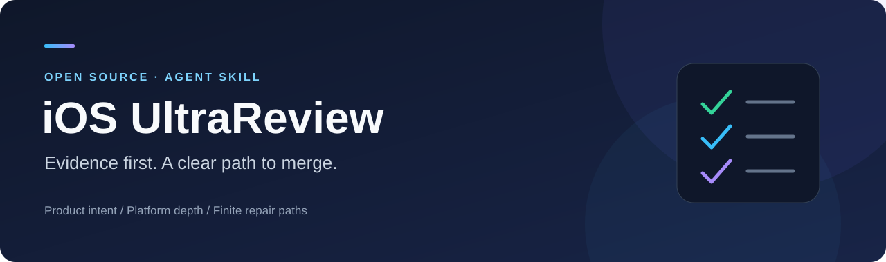

<p align="center">
  
</p>

<p align="center">
  <a href="LICENSE"></a>
  <a href="https://github.com/ImtiazDipto01/ios-ultrareview/releases"></a>
  <a href="https://agentskills.io"></a>
  <a href="https://github.com/ImtiazDipto01/ios-ultrareview/actions/workflows/validate.yml"></a>
</p>

# iOS UltraReview

**Give your coding agent a disciplined iOS PR review workflow—with actionable findings, honest evidence, and a finite path to merge.**

iOS UltraReview guides an agent through the decisions a senior iOS developer and architect should make: understand the product change, trace its consequences, check the affected platform behavior, and explain what needs to change. It supports first reviews and follow-up reviews of an iOS product, including affected iPad, extensions, and companion watch behavior.

It is an open-source **instruction skill**, not an autonomous service or a replacement for human review. The host agent supplies its model, tools, repository access, and execution permissions.

<p align="center">
  <a href="#install-in-one-command">Install</a> ·
  <a href="#your-first-review">First review</a> ·
  <a href="#how-the-review-works">Review phases</a> ·
  <a href="docs/scoring.md">Scoring</a> ·
  <a href="docs/evaluation.md">Evaluation</a> ·
  <a href="CONTRIBUTING.md">Contribute</a>
</p>

## What you get

- **Findings with consequences.** Each blocker explains the failure, affected behavior, smallest useful repair, and how to verify it.
- **A score you can act on.** Merge confidence uses half-points from 0.5 to 5.0. Only 4.5 and 5.0 are merge-ready.
- **A finite repair plan.** Stable `B` IDs track the required path to 4.5. Optional `E` IDs track an attainable path to 5.0.
- **Relevant platform depth.** The agent loads the iOS guidance triggered by the change, rather than applying every domain to every PR.
- **Evidence you can audit.** Build/test results identify the target, command or job, environment, and outcome. Unknowns stay visible.
- **Bounded re-review.** Verified repairs close previous items. Unchanged scope does not acquire a new wish list.

## Install in one command

You need Git and Node.js **22.20.0 or newer** for the tested installer version. Run this in a terminal:

```sh
npx skills add ImtiazDipto01/ios-ultrareview --skill ios-ultrareview
```

Choose your coding agent and installation scope in the prompts. For a non-interactive project installation into **Codex, Claude Code, and Cursor**:

```sh
npx skills add ImtiazDipto01/ios-ultrareview --skill ios-ultrareview --agent codex claude-code cursor --yes
```

Prefer installing into just one agent? Replace the agent list with `codex`, `claude-code`, or `cursor`. Add `--global` to make the skill available across your projects. Existing installations with the same name may be replaced; use project scope when trying a new version.

The command uses the third-party [Vercel Skills CLI](https://github.com/vercel-labs/skills). You do not need an npm account, an API key, or an Xcode installation to install the skill. Xcode or qualifying supplied evidence may be needed to validate a particular iOS PR.

**[Full installation guide →](docs/installation.md)** Global installs, manual installs, pinned releases, updates, removal, troubleshooting, and other agents.

## Your first review

1. Open your iOS repository in your coding agent.
2. Select or mention `ios-ultrareview`. In Codex, use `$ios-ultrareview`; in Claude Code, use `/ios-ultrareview`; in Cursor, select the skill or ask the agent to use it.
3. Give it a PR URL or exact base/head refs, plus the intended behavior and available evidence.

```text
Use ios-ultrareview to review https://github.com/OWNER/APP/pull/123.
Draft the review here.
Intent: users can retry a failed profile save without losing their draft.
Check the affected flows and explain any remaining build/test evidence gaps.
```

A local review works too:

```text
Use ios-ultrareview to review this repository from BASE_SHA to HEAD_SHA.
Intent: preserve iOS 17 and native iPad support after consolidating xcconfig files.
Draft findings, merge confidence, and the finite path to readiness.
```

Review requests produce a **draft**. Posting a GitHub review, editing source, changing signing, or performing release operations requires the corresponding authorization. The skill does not install a GitHub connector or grant new permissions.

## How the review works

| Phase | What happens | What you receive |
| --- | --- | --- |
| 1 · Acquire | Pin the exact target; recover the full diff and relevant consumers. | Base/head identity and coverage limits. |
| 2 · Understand | Read product intent, repository instructions, contracts, and existing discussions. | A clear statement of expected behavior. |
| 3 · Bound | Cover every behavior-relevant change; chunk large reviews with a coverage ledger. | A review of the complete target, or an explicit partial-review limit. |
| 4 · Inspect | Apply only the affected iOS and architecture lenses. | Demonstrated root causes, deduplicated by consequence. |
| 5 · Validate | Run suitable checks safely or evaluate supplied exact-target evidence. | PASS / FAIL / NOT RUN with provenance. |
| 6 · Score | Apply severity anchors and evidence caps. | Merge confidence and stable required `B` items. |
| 7 · Finish | Assess proportional excellence and present the draft. | Decision recommendation and optional, finite `E` items. |
| 8 · Re-review | Verify the repair/evidence delta against the prior review. | Closed items, remaining conditions, and updated confidence. |

**[Walk through the workflow →](docs/workflow.md)** Includes evidence examples, large PRs, and follow-up prompts.

## What the score means

This score measures confidence in **merging the exact PR target**. It does not rate the developer or the reviewing model.

| Score | Meaning | Next step |
| --- | --- | --- |
| 0.5–3.0 | Serious demonstrated failures; repair burden varies. | Resolve the concrete required items. |
| 3.5 | Consequential gaps across scope, or a material named intent/evidence gap. | Satisfy the published conditions. |
| 4.0 | Localized defects or material validation still missing. | Finish the bounded repairs or supply the missing evidence. |
| 4.5 | Merge-ready; applicable baseline evidence is complete. | Approval is recommended. Optional excellence remains optional. |
| 5.0 | Merge-ready; all applicable proportional evidence gates are complete. | Approval is recommended immediately. |

If validation is the only remaining gate, the score is **exactly 4.0**, and the review requests evidence without asking for a source change. An inaccessible, incomplete, or patch-only target receives **no whole-PR score**. A missing local Mac alone is not a cap: qualifying evidence from the exact target can satisfy a gate.

The [canonical rubric](skills/ios-ultrareview/references/scoring-and-severity.md) contains every half-point anchor, severity definition, mandatory cap, and decision rule.

## Platform and architecture coverage

The skill covers platform lifecycle and memory; Swift concurrency and language design; SwiftUI/UIKit ownership and interop; accessibility and localization; iPad scenes and input; companion watch behavior; persistence and sync; API contracts; build/release configuration; performance and observability; testing; authentication; and privacy.

Universal Links, notifications, background tasks, App Intents, widgets, Live Activities, App Clips, CloudKit, HealthKit, Catalyst, and visionOS compatibility are inspected when the product change makes them relevant. A PR does not need to adopt these technologies to earn 5.0.

Explore [domain routing](skills/ios-ultrareview/references/ios-review-domains.md), [platform integrations](skills/ios-ultrareview/references/apple-platform-integrations.md), and [performance diagnostics](skills/ios-ultrareview/references/performance-and-diagnostics.md).

## A finding you can use

> **[P1][B1] Save before completing setup**
>
> If saving fails, this path has already marked setup complete and dismissed it. Relaunch then skips setup without a profile. Await persistence before committing completion; preserve the draft on failure. Verify that a failing save keeps setup visible and the completion marker false.

**Illustrative example**, not a finding from your repository. Reports also distinguish code defects from questions, evidence limits, and optional improvements.

## Evidence behind the skill

The 1.0.0 development evaluation used small controlled defective/clean fixture pairs and a sequential repair review. Recorded outcomes included scene and API defect discovery, clean controls reaching 5.0, Xcode release-configuration checks, and convergence from **3.0 → 4.0 → 5.0**.

The public summary identifies **host-recorded configured model `gpt-6-sol`, reasoning effort `ultra`**, recovered after the original reports were frozen. It distinguishes candidate runtimes, aided discovery, reviewer outcomes, author checks, and whole-session token usage. It does not establish production accuracy, cross-model superiority, token savings, or physical-device reliability. Version 1.0.1 adds public packaging and provenance guards; those earlier reviewer runs were not rerun under the new version label.

**[Evaluation method and public records →](docs/evaluation.md)**

## Repository map

```text
skills/ios-ultrareview/   Installed skill: entrypoint, 12 references, agent metadata
docs/                   Installation, workflow, scoring, evaluation
evals/                  Maintainer fixture generators, validators, review freezer
tests/                  Publication-provenance regression tests
scripts/                Repository checks and installer smoke test
.github/                CI and issue templates
```

Maintainer evaluations are separate from the installed skill. Preserve the entire skill folder: copying only `SKILL.md` leaves its referenced guidance behind.

## Contribute

Useful contributions include a reproducible missed defect, a false blocker, a score that conflicts with its evidence, or a new platform case with a clean control. Start with [CONTRIBUTING.md](CONTRIBUTING.md). Report sensitive security issues using [SECURITY.md](SECURITY.md).

MIT licensed. See [LICENSE](LICENSE), [source attribution](skills/ios-ultrareview/references/sources.md), and [third-party notices](THIRD_PARTY_NOTICES.md). This independent project is not affiliated with Apple, OpenAI, Anthropic, Cursor, or Vercel.
